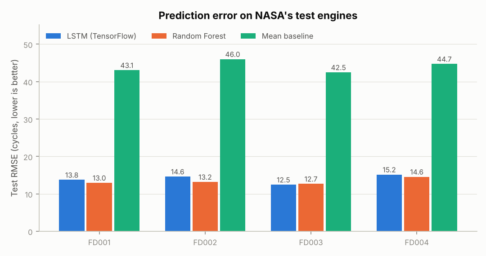
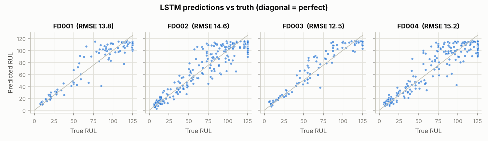
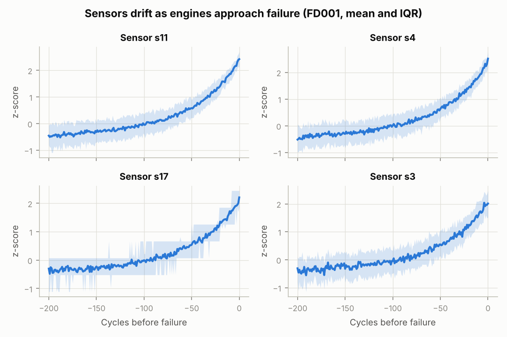
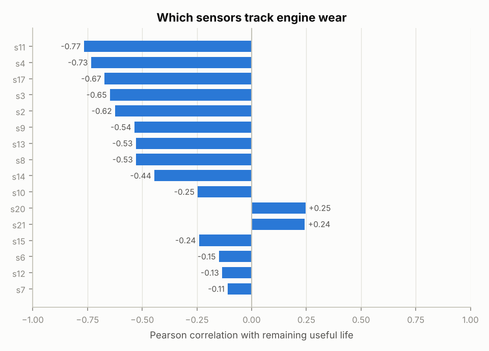
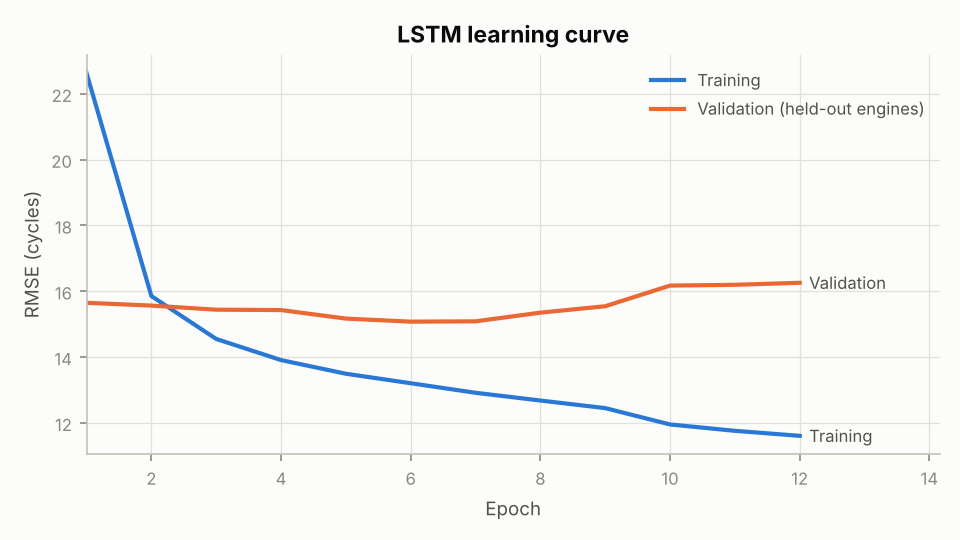

# Turbofan Engine Remaining Useful Life (RUL) Prediction

Predicting how many flight cycles a jet engine has left before failure, from its sensor history, using NASA's C-MAPSS turbofan degradation dataset. This is the core problem behind **predictive maintenance**: replace parts just before they fail, not too early (wasted life) and never too late (safety risk).

Built with Python, Pandas, NumPy, Scikit-learn and TensorFlow/Keras.

## Results

Scored on NASA's official test engines (707 engines across all four sub-datasets), with the true RUL capped at 125 cycles as is standard for this benchmark.

| Model | Test RMSE (cycles) | MAE | PHM08 score (lower is better) |
|---|---|---|---|
| Mean baseline (always predicts the average) | 44.7 | 37.4 | 376,079 |
| Random Forest on window summaries | **13.6** | **9.9** | **2,368** |
| LSTM (TensorFlow/Keras) | 14.4 | 11.1 | 2,557 |



**What the numbers say**

- Both models cut prediction error by about **3x** compared with the baseline.
- The **simpler Random Forest beat the LSTM overall**. The LSTM's learning curve shows why: validation error bottoms out at epoch 6 and then rises while training error keeps falling, a clear sign of overfitting. Early stopping restored the epoch-6 weights.
- **Close to failure the LSTM is better.** For engines within 30 cycles of failure, the LSTM's RMSE is 5.0 cycles against 6.1 for the Random Forest. This is the range where maintenance decisions are made.
- **Actionable insight: both models tend to predict failure too late near the end of life** (about 75% of predictions in the last 30 cycles are late). In practice, a safety margin should be subtracted from the predicted RUL before scheduling maintenance, because a late prediction means an engine keeps flying past its safe point.

| Error by distance to failure | Engines | LSTM RMSE | Random Forest RMSE | LSTM late predictions |
|---|---|---|---|---|
| 0-29 cycles left | 157 | 5.0 | 6.1 | 75% |
| 30-79 cycles left | 182 | 17.7 | 16.1 | 58% |
| 80+ cycles left | 368 | 15.3 | 14.6 | 31% |



## Dataset

[NASA C-MAPSS](https://www.nasa.gov/intelligent-systems-division/discovery-and-systems-health/pcoe/pcoe-data-set-repository/) (Saxena et al., 2008): simulated run-to-failure data for turbofan engines. Each row is one engine in one flight cycle, with 3 operational settings and 21 sensor readings (temperatures, pressures, fan and core speeds, fuel flow).

| Sub-dataset | Training engines | Training rows | Flight conditions | Fault modes |
|---|---|---|---|---|
| FD001 | 100 | 20,631 | 1 | 1 (compressor) |
| FD002 | 260 | 53,759 | 6 | 1 (compressor) |
| FD003 | 100 | 24,720 | 1 | 2 (compressor, fan) |
| FD004 | 249 | 61,249 | 6 | 2 (compressor, fan) |
| **Total** | **709** | **160,359** | | |

Plus 104,897 test rows (707 engines) whose true RUL is given only at their last recorded cycle. The raw files are in `data/raw/` with NASA's original readme.

## Exploratory analysis

**Five sensors never change** within a flight condition (s1, s5, s16, s18, s19), so they carry no wear signal and are dropped. 16 sensors are used.

**Sensors drift as engines wear.** Aligned at the moment of failure, the strongest sensors stay flat for most of the engine's life and then climb steeply in the last 50 to 100 cycles. This is why the RUL target is capped at 125: an engine far from failure looks healthy, and no model can tell 300 cycles from 200.



**Correlations depend on the fault mode.** Sensors s7, s12, s20 and s21 track wear strongly in FD001 (r = +0.70 to +0.75) but only weakly in the pooled data. In FD003, which adds fan degradation, s7 and s12 flip sign (r = -0.36 and -0.37) and s20 and s21 drop to near zero. The two fault modes push these sensors in opposite directions, so a model needs the other sensors to tell which fault is developing.



## Method

1. **Labelling.** For training engines, RUL = last cycle minus current cycle, capped at 125. For test engines, the RUL at the last cycle comes from `RUL_FD00x.txt`.
2. **Normalisation per flight condition.** The 3 operational settings are mapped to the 6 flight conditions, and each sensor is z-scored within its condition using training statistics only. Raw readings jump whenever an aircraft changes condition; normalising within a condition removes that jump so the slow wear trend is visible. This is what lets one model handle FD002 and FD004.
3. **Validation by engine, not by row.** 20% of engines per sub-dataset are held out. Splitting by row would put neighbouring cycles of the same engine on both sides and make validation scores look too good.
4. **Sliding windows.** Each engine's history becomes 30-cycle windows (128,469 for training, 31,890 for validation); short test engines are padded at the front.
5. **Models.**
   - *Mean baseline*: always predicts the average training RUL.
   - *Random Forest*: 150 trees on 48 summary features per window (last value, mean and linear slope of each sensor).
   - *LSTM*: two stacked LSTM layers (64, 32 units) with dropout, trained in TensorFlow/Keras on 0-1 scaled targets with early stopping and learning-rate reduction.
6. **Evaluation.** RMSE, MAE and the asymmetric PHM08 score, which penalises late predictions more than early ones.



## Run it

```bash
pip install -r requirements.txt
python eda.py          # dataset summary + EDA charts      (under 1 minute)
python train.py        # all three models + results charts (about 8-20 minutes on CPU)
python train.py --quick   # 2-epoch smoke test
pytest                 # 8 unit tests: labels, windows, padding, split, scaler, metric
```

Outputs: `reports/metrics.json`, `reports/eda_summary.json`, `reports/test_predictions.csv`, `reports/figures/*.png`, `models/lstm.keras`. Results above are from seed 42; TensorFlow on a different CPU can shift the LSTM's numbers slightly.

## Project structure

```
rul/data.py       loading, RUL labels, condition normalisation, windows, engine split
rul/metrics.py    RMSE, MAE, PHM08 score
rul/plotting.py   shared chart style
eda.py            exploratory analysis
train.py          training and evaluation pipeline
tests/            pytest unit tests
data/raw/         NASA C-MAPSS files
reports/          metrics, predictions, figures
```

## Limitations and next steps

- The LSTM overfits after a few epochs. Next to try: a longer window, a 1D-CNN front end, or tuning dropout, selected on validation engines only.
- One model covers all four sub-datasets. A separate model per fault mode might do better on FD003 and FD004.
- The flight-condition history (how much time an engine spent at high throttle) is not used as a feature yet.
- Predictions near failure are biased late; a calibrated safety margin, or training with an asymmetric loss like the PHM08 score, would address that directly.

## Reference

A. Saxena, K. Goebel, D. Simon and N. Eklund, "Damage Propagation Modeling for Aircraft Engine Run-to-Failure Simulation," *Proceedings of the 1st International Conference on Prognostics and Health Management (PHM08)*, Denver, 2008.
